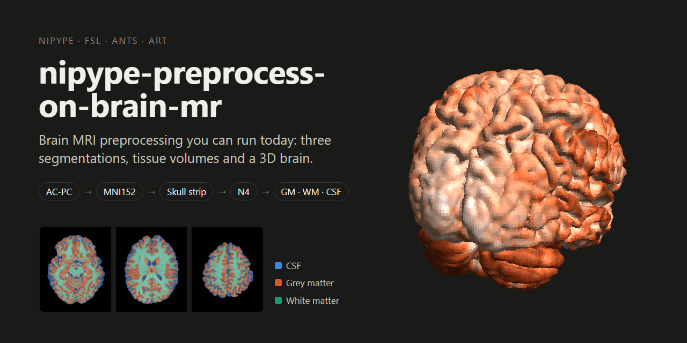
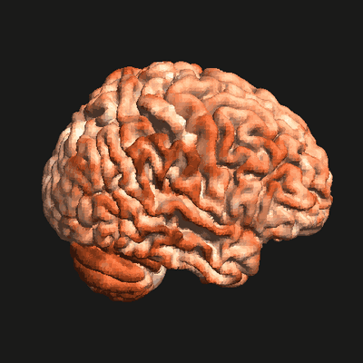
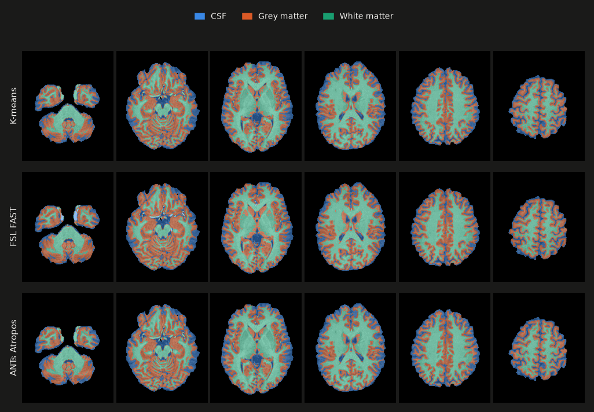
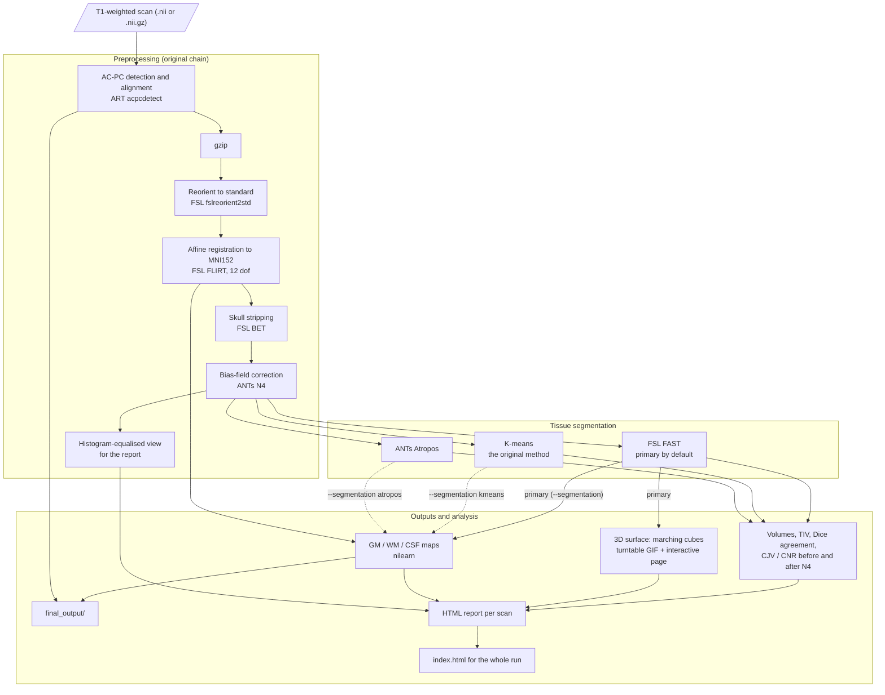
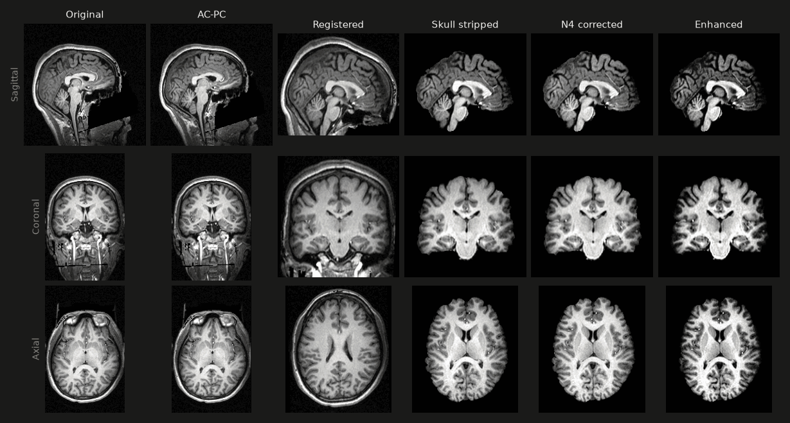
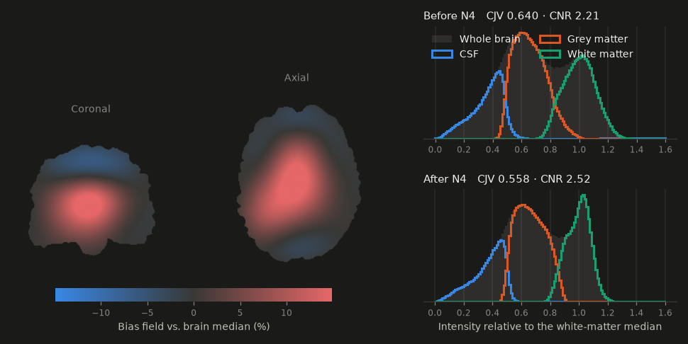
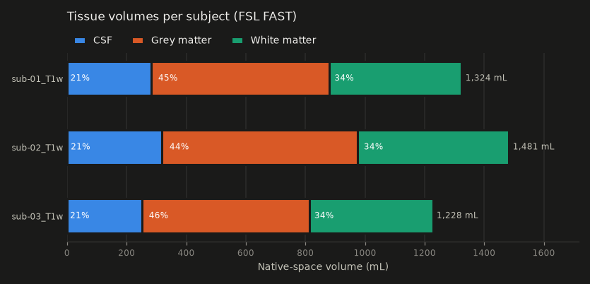
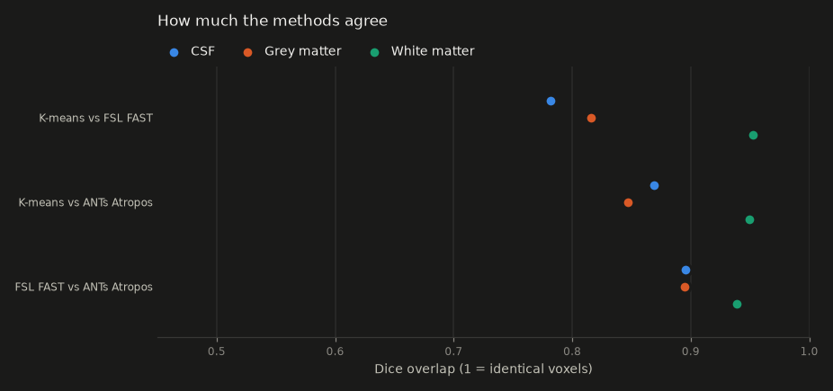

<p align="center">
  
</p>

[](https://github.com/NatLee/nipype-preprocess-on-brain-mr/actions/workflows/ci.yml)


[](LICENSE)

A brain MRI preprocessing pipeline built from [nipype](https://nipype.readthedocs.io/) nodes, small
enough to read in an afternoon and complete enough to learn from. Point it at T1-weighted scans and
each one is AC-PC aligned, registered to the MNI152 template, skull stripped, bias corrected and split
into grey matter, white matter and CSF with FSL FAST (or K-means, the original method, or ANTs Atropos;
your choice). Then it goes further than the classic tutorial: it segments the brain all three ways and
measures how much they agree, turns the labels into tissue volumes,
checks what bias correction actually changed, renders the brain in 3D, and writes an HTML report per
scan. Everything runs in one Docker image, on CPU, with openly licensed demo scans.

<table>
  <tr>
    <td width="44%"></td>
    <td></td>
  </tr>
  <tr>
    <td>Marching-cubes surface of one demo brain, coloured by how deep the grey matter is under each point.</td>
    <td>The same slices segmented three ways: K-means (the original method), FSL FAST and ANTs Atropos.</td>
  </tr>
</table>

## What it does



Each box is a nipype node; nipype runs them in order, in parallel across scans when you ask it to,
and draws the graph for you (`output/graph.png`). Every node writes its result into its own folder,
so you can open any intermediate image in a viewer such as [FSLeyes](https://fsl.fmrib.ox.ac.uk/fsl/docs/#/utilities/fsleyes)
or [ITK-SNAP](http://www.itksnap.org/).

## Quick start

You need Docker (8 GB of memory for the container) and about 2 GB of disk for the image.

```bash
git clone https://github.com/NatLee/nipype-preprocess-on-brain-mr.git
cd nipype-preprocess-on-brain-mr

# 1. Build the image (FSL, ANTs, acpcdetect and Python 3.14; about 2 GB)
docker build -t nipype-preprocess-on-brain-mr .

# 2. Download three demo scans (OpenNeuro ds000001, CC0) into ./data
docker run --rm -v "$PWD/data:/data" nipype-preprocess-on-brain-mr python fetch_demo_data.py

# 3. Run the pipeline on everything in ./data, results in ./output
docker run --rm --memory 8g --user "$(id -u):$(id -g)" \
    -v "$PWD/data:/data:ro" -v "$PWD/output:/output" \
    nipype-preprocess-on-brain-mr
```

Then open `output/index.html`. One scan at a time, each takes roughly 5 to 7 minutes on the 1 mm
template; with `--n-procs 3` and 8 CPU cores the three demo scans took about 7 minutes in total and
peaked at 2.5 GB of memory. For a quick look, add
`--reference /opt/fsl/data/standard/MNI152_T1_2mm.nii.gz` (about two minutes per scan).

`--user` makes the result files yours instead of root's (leave it out on Windows and macOS).

### Use your own scans

Put `.nii` or `.nii.gz` T1-weighted scans in `./data` (DICOM? convert them first with
[dcm2niix](https://github.com/rordenlab/dcm2niix)). Each scan gets a folder in `./output` named after
the file. Scans that look nothing like an adult T1-weighted head (other contrasts, babies, heavy
artefacts) may fail at the AC-PC or registration step; the report shows the detected landmarks so you
can check.

## Examples

```bash
# Everything, one scan at a time (the defaults: /data -> /output)
docker run --rm --memory 8g -v "$PWD/data:/data:ro" -v "$PWD/output:/output" nipype-preprocess-on-brain-mr

# Three scans in parallel
docker run ... nipype-preprocess-on-brain-mr python workflow.py --n-procs 3

# Use ANTs Atropos for the tissue maps, the 3D brain and the summary (FAST is the default)
docker run ... nipype-preprocess-on-brain-mr python workflow.py --segmentation atropos

# Like the original pipeline: K-means only, no comparison, no 3D render
docker run ... nipype-preprocess-on-brain-mr python workflow.py --segmentation kmeans --methods --no-3d

# FAST compared with K-means only, on the 2 mm template (8 times fewer voxels, a few minutes per scan)
docker run ... nipype-preprocess-on-brain-mr python workflow.py --methods kmeans \
    --reference /opt/fsl/data/standard/MNI152_T1_2mm.nii.gz

# All options
docker run --rm nipype-preprocess-on-brain-mr python workflow.py --help

# A shell inside the image with ./data and ./output mounted
./dev-bash.sh
```

## What you get

```
output/
├── index.html                  all scans: volumes table, chart, 3D brains, links to the reports
├── cohort/volumetrics.csv      every scan x every method in one table
├── graph.png, graph_detailed.png   the nipype workflow graph
└── sub-01_T1w/
    ├── acpc/                   AC-PC oriented scan, landmark previews, transform matrices
    ├── zip/  orient2std/  registration/  skull_stripping/  bias_correction/  enhancement/
    ├── segmentation/           K-means labels and weighted images (the original output)
    ├── segmentation_fast/  segmentation_atropos/   the other two methods
    ├── draw_segmentation/      GM@map.png, WM@map.png, CSF@map.png (nilearn, primary method)
    ├── analysis/               volumetrics.csv, agreement.csv, quality.json
    ├── render3d/               brain_3d.gif, brain_3d.html (interactive)
    ├── report/index.html       the QC report for this scan
    └── final_output/           the files most people want, in one place
```

### The report

Every scan gets a page with each step side by side, the AC-PC landmarks acpcdetect found, what N4
changed, the three segmentations with their volumes and agreement, the 3D brain and the original
probability maps.

<p align="center"></p>

**Bias correction, measured.** The scanner makes some parts of the head brighter than others. N4
estimates that smooth drift (left) and divides it out; afterwards the grey- and white-matter peaks are
narrower and further apart (right). The report puts numbers on it: the coefficient of joint variation
(CJV, lower is better) and the grey/white contrast-to-noise ratio (CNR, higher is better).

<p align="center"></p>

**Volumes and agreement.** Volumes are counted in template space and divided by the volume scale of
the affine registration (the determinant of FLIRT's matrix), which gives an estimate at the scan's own
size. Agreement between methods is the Dice overlap per tissue (1 = the same voxels).

<p align="center">
  
  
</p>

Results for the three demo scans (1 mm template, FSL FAST volumes at each scan's own size):

| Scan | TIV (mL) | Grey matter | White matter | CSF | CJV before → after N4 | Grey-matter Dice, FAST vs Atropos |
|---|---:|---:|---:|---:|---:|---:|
| sub-01 | 1,324 | 45.1% | 33.6% | 21.3% | 0.64 → 0.56 | 0.89 |
| sub-02 | 1,481 | 44.4% | 34.1% | 21.4% | 0.63 → 0.54 | 0.92 |
| sub-03 | 1,228 | 45.7% | 33.8% | 20.6% | 0.64 → 0.56 | 0.87 |

These are three healthy adults aged 24 to 27, and FAST puts grey matter at about 45% of the
intracranial volume and white matter at about a third. N4 lowered the grey/white CJV on every scan.

### Why FSL FAST is the default

The tissue maps (`GM@map.png` and friends, `final_output/`), the QC numbers, the 3D brain and the
summary page all come from one primary segmentation. It used to be K-means; since November 2026 it
is FSL FAST (`--segmentation kmeans` brings the old choice back, and all three methods still run for
the comparison). K-means has no spatial model and no intensity model: it
sorts every voxel by brightness alone, so the in-between voxels on the border of grey and white matter
are cut by a hard threshold. FAST models partial-volume voxels at tissue borders, neighbourhood
smoothness and the remaining bias, and it is the most widely used and validated of the three (it is the
FSL standard behind SIENAX, FSL-VBM and `fsl_anat`). Even on the corrected intensities, K-means gives
about 5 to 7 points less grey matter and 2 to 4 points more white matter than FAST on the demo scans:

| Scan | K-means CSF / GM / WM | FAST CSF / GM / WM | Atropos CSF / GM / WM |
|---|---:|---:|---:|
| sub-01 | 24.4 / 39.7 / 35.9% | 21.3 / 45.1 / 33.6% | 25.2 / 38.4 / 36.4% |
| sub-02 | 22.1 / 39.7 / 38.2% | 21.4 / 44.4 / 34.1% | 22.4 / 39.2 / 38.4% |
| sub-03 | 24.2 / 39.0 / 36.7% | 20.6 / 45.7 / 33.8% | 26.8 / 37.3 / 35.9% |

Atropos, which has a spatial model but no partial-volume model, lands close to K-means here. The
volumes CSV and every report keep all three, so you can see the spread for your own scans.

### Why K-means no longer reads the equalised image

The first version of this comparison showed K-means cutting every brain into almost exactly equal
thirds. That came from the pipeline, not from the brains: K-means clustered the histogram-equalised
image, equalisation flattens the histogram, and three clusters on a flat histogram end up the same
size. K-means now clusters the bias-corrected brain, the same image FAST and Atropos get, after the
same percentile clipping as before but without the equalisation. The equalised image is still made
and shown in the report. This changes the K-means output on purpose:

| Scan | K-means CSF / GM / WM, equalised (old) | K-means CSF / GM / WM, now | GM Dice vs FAST, old → now | GM Dice vs Atropos, old → now |
|---|---:|---:|---:|---:|
| sub-01 | 32.8 / 34.3 / 33.0% | 24.4 / 39.7 / 35.9% | 0.82 → 0.91 | 0.85 → 0.95 |
| sub-02 | 33.0 / 34.0 / 33.0% | 22.1 / 39.7 / 38.2% | 0.82 → 0.93 | 0.78 → 0.96 |
| sub-03 | 32.6 / 33.9 / 33.5% | 24.2 / 39.0 / 36.7% | 0.80 → 0.89 | 0.88 → 0.94 |

All three methods now agree closely on white matter (Dice 0.93 to 0.99 for every pair). The
remaining differences sit on the border between grey matter and CSF, where FAST calls a few more
voxels grey matter than K-means and Atropos do (Dice 0.85 to 0.96).

## Inside the Docker image

The image holds exactly the tools the pipeline calls and nothing else; `docker images` reports
**2.0 GB**. The layers:

| Part | What | Size |
|---|---|---|
| Base | `python:3.14-slim` plus graphviz, netpbm, bc/dc and BLAS/LAPACK from apt | 0.27 GB |
| Python packages | nipype 1.12, nibabel, nilearn, scikit-learn, scikit-image, matplotlib, plotly, pandas | 0.73 GB |
| FSL (5 conda packages) | `fslreorient2std`, `flirt`, `bet`, `fast`, `fslmaths` and friends | 0.47 GB |
| ANTs 2.6.5 | `N4BiasFieldCorrection` and `Atropos` only, from the official release | 45 MB |
| ART | `acpcdetect` and its three model files (bundled in `utils/`) | 25 MB |
| MNI152 template | FSL's MNI152 T1 at 1 mm and 2 mm (TemplateFlow mirror, SHA-256 checked) | 13 MB |

The previous setup built a neurodocker image that downloaded the whole of FSL 6.0.5.1 (a 4.1 GB
archive before unpacking) and every ANTs program (a 709 MB zip), then a second image on top. One
`Dockerfile` with three build stages replaces both. It runs on CPU only; give the container
`--memory 8g` and the 1 mm pipeline fits comfortably.

## Data and licences

- **Demo scans**: [OpenNeuro ds000001](https://openneuro.org/datasets/ds000001) (Schonberg et al.,
  2012), released under **CC0**. `src/fetch_demo_data.py` downloads them and checks each file's
  SHA-256 ([manifest](src/demo_data.json)); no scan is stored in this repository.
- **FSL** is free for non-commercial use only ([licence](https://fsl.fmrib.ox.ac.uk/fsl/docs/#/license)).
  Build the image yourself and do not publish it.
- **ANTs** is Apache 2.0. **ART** (`acpcdetect`, by Babak Ardekani, from [NITRC](https://www.nitrc.org/projects/art))
  is bundled as it was in the original project; ATRA, also in `utils/`, is not used by the pipeline.
- **MNI152 template**: FSL's MNI ICBM 152 non-linear 6th generation template, fetched from
  [TemplateFlow](https://www.templateflow.org/) (`tpl-MNI152NLin6Asym`); same voxels as FSL's copy,
  stored right-to-left instead of left-to-right.
- Earlier versions of this README showed ADNI scans. ADNI data cannot be redistributed, so those
  pictures are gone and every image here comes from the CC0 demo scans.
- The code is MIT licensed. This is a teaching and research tool, not a medical device.

## Development

```bash
# Fast tests: pure Python, no FSL/ANTs needed (what CI runs on Python 3.12-3.14)
pip install -r requirements-dev.txt
python -m pytest -m "not neuro"

# The full pipeline on one demo scan at 2 mm, inside the image (what CI's Docker job runs)
docker build --target test -t nipype-preprocess-on-brain-mr:test .
docker run --rm --memory 8g -v "$PWD/data:/data:ro" nipype-preprocess-on-brain-mr:test python -m pytest -m neuro /tests
```

The enhancement and K-means code is tested against a verbatim copy of the 2024 implementation, so the
refactor cannot quietly change the original outputs. Synthetic "phantom" brains with known tissue labels
(`tests/phantom.py`) cover the rest without any real data.

## References

- [nipype](https://nipype.readthedocs.io/), [nilearn](https://nilearn.github.io/), [FSL](https://fsl.fmrib.ox.ac.uk/), [ANTs](https://github.com/ANTsX/ANTs)
- Ardekani, B. A. & Bachman, A. H. (2009). Model-based automatic detection of the anterior and posterior commissures on MRI scans. *NeuroImage* 46(3).
- Tustison, N. J. et al. (2010). N4ITK: improved N3 bias correction. *IEEE TMI* 29(6).
- Zhang, Y., Brady, M. & Smith, S. (2001). Segmentation of brain MR images through a hidden Markov random field model (FAST). *IEEE TMI* 20(1).
- Avants, B. B. et al. (2011). An open source multivariate framework for n-tissue segmentation (Atropos). *Neuroinformatics* 9(4).
- [quqixun/BrainPrep](https://github.com/quqixun/BrainPrep), which inspired the original pipeline.

## Contributor

<!-- ALL-CONTRIBUTORS-LIST:START - Do not remove or modify this section -->
<!-- prettier-ignore-start -->
<!-- markdownlint-disable -->
<table>
  <tbody>
    <tr>
      <td align="center"><a href="https://github.com/NatLee"><br /><sub><b>Nat Lee</b></sub></a></td>
    </tr>
  </tbody>
</table>

<!-- markdownlint-restore -->
<!-- prettier-ignore-end -->

<!-- ALL-CONTRIBUTORS-LIST:END -->
